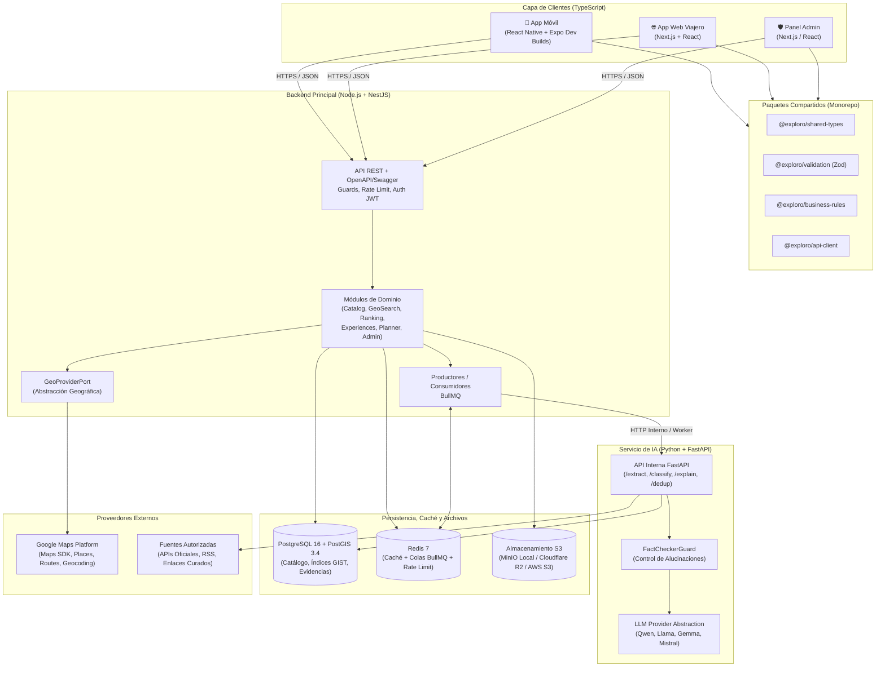
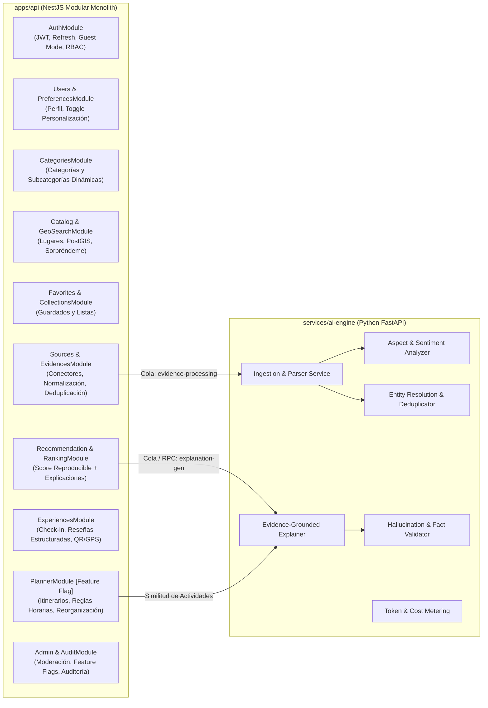
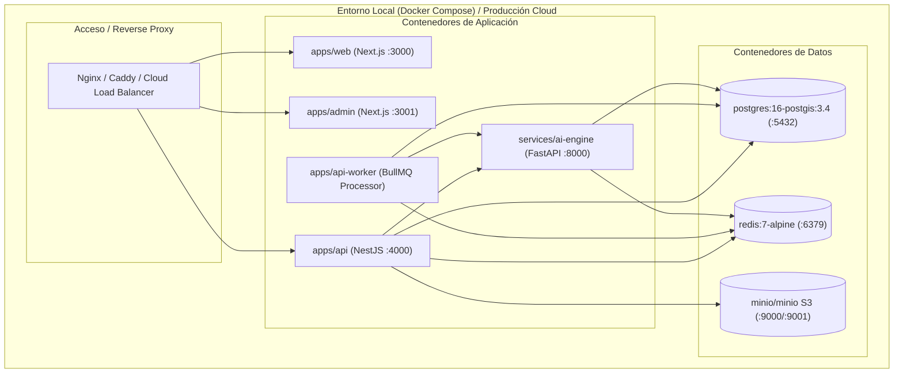
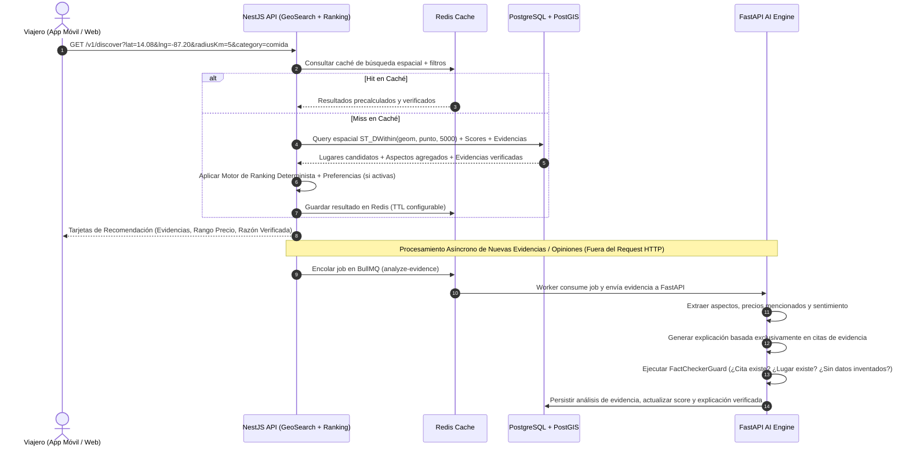

# Arquitectura Técnica — Exploro

**Versión:** 1.0.0 (Fase 0 — Propuesta para Aprobación)  
**Fecha:** 2026-11-10  
**Estado:** Pendiente de validación del propietario del proyecto

---

## 1. Visión Arquitectónica

**Exploro** es una plataforma inteligente de descubrimiento local y planificación de viajes basada en evidencias verificables, opiniones reales y motores deterministas apoyados por Inteligencia Artificial.

La arquitectura sigue un enfoque de **Monolito Modular en el Backend Principal (`apps/api` con NestJS)** acoplado asíncronamente a un **Microservicio Especializado de IA y Datos (`services/ai-engine` con Python + FastAPI)**, respaldados por **PostgreSQL + PostGIS**, **Redis + BullMQ**, y clientes multiplataforma en **React Native + Expo (`apps/mobile`)**, **Next.js (`apps/web`)** y **Panel Administrativo (`apps/admin`)** dentro de un monorepositorio gestionado con **pnpm + Turborepo**.

---

## 2. Diagrama de Arquitectura General



---

## 3. Diagrama de Módulos del Sistema



---

## 4. Diagrama de Despliegue e Infraestructura



---

## 5. Flujo de Búsqueda, Ranking y Control de Alucinaciones



---

## 6. Estructura del Monorepositorio Validada

Se valida y adopta la estructura basada en **pnpm workspaces + Turborepo**:

```text
Exploro/
├── apps/
│   ├── mobile/                 # React Native + Expo (Development Builds, TypeScript)
│   ├── web/                    # Next.js App Router para viajeros (TypeScript)
│   ├── api/                    # Backend principal NestJS + Swagger + BullMQ (TypeScript)
│   └── admin/                  # Panel administrativo Next.js con RBAC y auditoría (TypeScript)
│
├── services/
│   └── ai-engine/              # Microservicio Python 3.12 + FastAPI + Pydantic v2 + Pytest
│       ├── app/
│       │   ├── api/            # Endpoints internos (/v1/extract, /v1/explain, /v1/similarity)
│       │   ├── core/           # Configuración, seguridad API Key interna, logging
│       │   ├── providers/      # Abstracción multi-LLM (Ollama, OpenRouter, Together, Gemini, OpenAI)
│       │   ├── pipelines/      # Extracción de aspectos, normalización, deduplicación
│       │   ├── guards/         # Control anti-alucinaciones y verificación de evidencias
│       │   └── schemas/        # Contratos Pydantic estrictos
│       ├── tests/
│       ├── Dockerfile
│       └── pyproject.toml
│
├── packages/
│   ├── shared-types/           # Interfaces, DTOs, enums y tipos de dominio compartidos
│   ├── validation/             # Esquemas Zod reutilizables (móvil, web, admin, api)
│   ├── api-client/             # Cliente HTTP tipado y hooks de consulta
│   ├── business-rules/         # Reglas deterministas (horarios, presupuesto, elegibilidad, ranking base)
│   └── config/                 # Configuraciones compartidas de ESLint, TypeScript (tsconfig), Prettier
│
├── infrastructure/
│   ├── docker/                 # Dockerfiles y docker-compose.yml (PostGIS, Redis, MinIO, servicios)
│   ├── database/               # Scripts de inicialización PostGIS, extensiones y backups
│   └── deployment/             # Configuraciones de despliegue, plantillas de variables de entorno
│
├── docs/                       # Documentación técnica complementaria y diagramas adicionales
├── scripts/                    # Scripts de automatización (setup, seed, validación, healthchecks)
│
├── MASTER_PROMPT.md            # Instrucciones maestras del proyecto
├── PROJECT_STATUS.md           # Estado general del proyecto
├── ROADMAP.md                  # Fases, entregables y desglose de tareas
├── DECISIONS.md                # Decisiones técnicas y de producto aprobadas
├── PENDING_DECISIONS.md        # Preguntas pendientes de definición por el propietario
├── ARCHITECTURE.md             # Este documento
├── DATABASE.md                 # Modelo de datos relacional y geoespacial
├── API.md                      # Contratos de API REST y comunicación interna
├── TESTING.md                  # Estrategia y matriz de pruebas
├── CHANGELOG.md                # Registro de cambios relevantes
├── package.json                # Root workspace config
├── pnpm-workspace.yaml         # Definición de workspaces pnpm
└── turbo.json                  # Pipeline de construcción, pruebas y caché de Turborepo
```

---

## 7. Decisiones Clave de Arquitectura

### 7.1 Estrategia de Comunicación entre Servicios
- **Clientes (`mobile`, `web`, `admin`) ↔ `apps/api`:** REST sobre HTTPS con documentación OpenAPI 3.1 (Swagger) autogenerada y tipado compartido mediante `@exploro/shared-types` y `@exploro/api-client`.
- **`apps/api` ↔ `services/ai-engine`:**
  1. **Asíncrono por defecto (vía Redis + BullMQ):** Toda ingesta de fuentes externas, extracción de aspectos de reseñas, recálculo de scores y generación de explicaciones de catálogo se ejecuta en segundo plano. Ninguna petición de usuario espera por procesamiento pesado de IA.
  2. **Síncrono interno con timeout estricto:** Únicamente para operaciones interactivas puntuales (ej. clasificación de similitud en el planificador asistido si no está en caché), protegido por autenticación mutua de servicio (`X-Internal-Service-Key`), circuit breaker y fallback determinista basado en etiquetas/categorías.

### 7.2 Estrategia de Autenticación y Autorización
- **Modo Exploración sin Cuenta (Guest):** Los endpoints de catálogo, categorías, búsqueda geográfica y visualización de evidencias son accesibles sin registro. En móvil/web se permite guardar preferencias básicas en almacenamiento local (`MMKV` / `AsyncStorage` / `localStorage`) y sincronizarlas al crear cuenta.
- **Usuarios Autenticados:** JWT de corta duración (`accessToken`: 15 min) + `refreshToken` rotativo almacenado en base de datos (con hash SHA-256) y revocable por sesión/dispositivo. Contraseñas hasheadas con **Argon2id**.
- **Control de Acceso Basado en Roles (RBAC):**
  - `TRAVELER`: Usuario estándar (favoritos, colecciones, check-in de actividades, opiniones propias, itinerarios).
  - `MODERATOR`: Revisión de evidencias ambiguas y reportes sin permiso de borrado destructivo.
  - `ADMIN`: Gestión de catálogo, categorías, conectores y feature flags, sujeto a **registro inmutable en `audit_logs`** (quién, cuándo, valor anterior, valor nuevo, motivo obligatorio).

### 7.3 Estrategia de Caché y Rendimiento
- **Nivel 1 (Redis - Geo & Catálogo):** Caché de consultas frecuentes por celda geográfica (Geohash / precisión redondeada de coordenadas + categoría + radio) con TTL de 5 a 15 minutos.
- **Nivel 2 (Redis - Análisis de IA):** Hash SHA-256 del contenido de cada evidencia (`content_hash`). Si una evidencia o texto ya fue analizado por la misma versión del prompt/modelo, no se vuelve a invocar al LLM.
- **Nivel 3 (Cliente Móvil / Web):** Caché de estado de servidor con `@tanstack/react-query` y persistencia offline para categorías, favoritos, colecciones e itinerarios activos.

### 7.4 Estrategia de Control de Costos (FinOps desde Diseño)

| Componente | Riesgo de Costo | Estrategia Técnica de Mitigación | Alternativa Económica / Local |
| :--- | :--- | :--- | :--- |
| **Google Maps Platform** | Alto costo en Places Autocomplete, Place Details y Routes API si se invoca sin restricciones. | 1. Uso obligatorio de `sessionToken` en Autocomplete.<br>2. Uso obligatorio de `FieldMask` pidiendo solo campos indispensables (`id`, `displayName`, `location`, `regularOpeningHours`).<br>3. Búsquedas por radio ("cerca de mí") resueltas en **PostGIS** propio, no llamando a Google Nearby Search en cada consulta.<br>4. Presupuesto y alertas en Google Cloud. | **MapLibre GL / OpenStreetMap / Nominatim** integrable mediante el puerto `GeoProviderPort` sin reescribir lógica de dominio. |
| **Procesamiento de IA (LLMs)** | Costo por millón de tokens si se usan modelos frontera para cada opinión. | 1. Enrutamiento por tarea (`ModelRouter`): modelos abiertos pequeños (`Qwen2.5-7B`, `Gemma-2-9B`, `Llama-3.1-8B`) para extracción y clasificación.<br>2. Procesamiento por lotes (batch) en BullMQ.<br>3. Registro de consumo en `ai_usage_logs` y límite diario por entorno. | **Ollama / vLLM** en desarrollo local (\$0) y proveedores económicos de modelos abiertos (Groq, Together AI, DeepInfra, OpenRouter) en producción. |
| **Almacenamiento Multimedia** | Costo de transferencia (egress) y almacenamiento de fotos de alta resolución. | 1. Compresión y conversión a **WebP/AVIF** antes de almacenar.<br>2. Subida mediante URLs prefirmadas con límite de tamaño (ej. máx. 5 MB). | **MinIO** en Docker local (\$0); **Cloudflare R2** en producción (\$0 costo de egress y capa gratuita de 10 GB/mes). |
| **Base de Datos y Caché** | Instancias gestionadas costosas en nubes tradicionales. | Índices espaciales GIST optimizados y pooling de conexiones. | Contenedores Docker en VPS (Hetzner / Netcup / Railway) con backups automatizados a S3. |
| **Builds Móviles** | Límites de minutos en la nube de EAS Build. | Uso de **Expo Prebuild (`npx expo run:android`)** para compilaciones locales ilimitadas y gratuitas en desarrollo, reservando EAS Build para iOS y releases. | Compilación local Android + GitHub Actions con caché de Gradle. |

