# Modelo de Base de Datos — Exploro

**Versión:** 1.0.0 (Fase 0 — Diseño Inicial)  
**Motor:** PostgreSQL 16 + Extensión PostGIS 3.4 + `pg_trgm` (búsqueda difusa y deduplicación) + `uuid-ossp` / `pgcrypto`  
**Estrategia de Migraciones:** Versionadas y deterministas (Prisma ORM / TypeORM con soporte SQL nativo para tipos e índices PostGIS)

---

## 1. Principios de Diseño de Datos

1. **Separación Estricta de Datos Propios vs. Terceros:**
   - Los datos curados y verificados de Exploro viven en `places`, `establishments`, `activities` y `place_scores`.
   - Las referencias operativas externas (como `google_place_id` y cachés temporales permitidos por políticas de atribución) se aíslan en `place_external_refs`.
2. **Trazabilidad Total de Evidencias:**
   - Ninguna explicación o atributo destacado existe sin vínculo a registros en `evidences` o `user_experiences`.
3. **Geoespacial Nativo en PostGIS:**
   - Coordenadas almacenadas en columnas `location geography(Point, 4326)` con índices `GIST` para consultas en metros reales (`ST_DWithin`, `ST_Distance`) sin distorsión de proyección.
4. **Identificadores Estables e Inmutabilidad de Auditoría:**
   - Uso de `UUID v7` (ordenables temporalmente) como claves primarias y tabla `audit_logs` de solo inserción (append-only) para acciones administrativas.

---

## 2. Diagrama Entidad-Relación (ERD)

```mermaid
erDiagram
    USERS ||--o| USER_PREFERENCES : "configura"
    USERS ||--o{ USER_SESSIONS : "mantiene"
    USERS ||--o{ FAVORITES : "guarda"
    USERS ||--o{ COLLECTIONS : "crea"
    COLLECTIONS ||--o{ COLLECTION_ITEMS : "contiene"
    USERS ||--o{ ACTIVITY_LOGS : "inicia/finaliza"
    ACTIVITY_LOGS ||--o| USER_REVIEWS : "genera"
    USERS ||--o{ TRIPS : "planifica (Fase 6)"

    COUNTRIES ||--o{ CITIES : "tiene"
    CITIES ||--o{ DESTINATIONS : "incluye"
    DESTINATIONS ||--o{ PLACES : "ubica"

    CATEGORIES ||--o{ SUBCATEGORIES : "agrupa"
    CATEGORIES ||--o{ PLACES : "clasifica"
    SUBCATEGORIES ||--o{ PLACES : "subclasifica"

    PLACES ||--o| ESTABLISHMENTS : "detalle comercial"
    PLACES ||--o{ ACTIVITIES : "ofrece"
    PLACES ||--o{ PLACE_MEDIA : "muestra"
    PLACES ||--o{ PLACE_EXTERNAL_REFS : "vincula proveedor"
    PLACES ||--o| PLACE_SCORES : "consolida ranking"

    SOURCES ||--o{ EVIDENCES : "provee"
    PLACES ||--o{ EVIDENCES : "respaldado por"
    EVIDENCES ||--o{ EVIDENCE_ASPECTS : "extrae"
    PLACES ||--o{ USER_REVIEWS : "recibe"

    TRIPS ||--o{ TRIP_DAYS : "divide en"
    TRIP_DAYS ||--o{ TRIP_ITEMS : "programa"
    PLACES ||--o{ TRIP_ITEMS : "incluye en itinerario"

    USERS {
        uuid id PK
        string email UK
        string password_hash
        string display_name
        string role "TRAVELER | MODERATOR | ADMIN"
        boolean is_active
        timestamptz created_at
        timestamptz updated_at
    }

    USER_PREFERENCES {
        uuid id PK
        uuid user_id FK
        boolean personalization_enabled "Activable/Desactivable"
        string preferred_mode "TRAVELER | LOCAL"
        string budget_tier "FREE | LOW | MEDIUM | HIGH | LUXURY"
        jsonb favorite_categories
        jsonb travel_styles "FAMILIAR, AVENTURERO, GASTRONOMICO..."
        string companion_default "SOLO | COUPLE | FAMILY | FRIENDS"
        timestamptz updated_at
    }

    COUNTRIES {
        uuid id PK
        string iso_code UK "HN, GT, SV, CR..."
        string name
        string currency_code "HNL, GTQ, USD..."
    }

    CITIES {
        uuid id PK
        uuid country_id FK
        string name
        string slug
        geography center_point "Point(4326)"
    }

    DESTINATIONS {
        uuid id PK
        uuid city_id FK
        string name
        string slug
        string description
        geography center_point "Point(4326)"
        geography boundary "Polygon(4326) nullable"
        boolean is_featured
    }

    CATEGORIES {
        uuid id PK
        string slug UK "comida, turismo, entretenimiento..."
        string name
        string icon_name
        int sort_order
        boolean is_active
    }

    SUBCATEGORIES {
        uuid id PK
        uuid category_id FK
        string slug UK "miradores, monumentos, naturaleza..."
        string name
        int sort_order
        boolean is_active
    }

    PLACES {
        uuid id PK
        uuid destination_id FK
        uuid city_id FK
        uuid category_id FK
        uuid subcategory_id FK
        string name
        string normalized_name "Para deduplicación"
        string slug UK
        text description
        string address_text
        geography location "Point(4326) GIST Index"
        string price_tier "FREE | LOW | MEDIUM | HIGH | UNKNOWN"
        decimal avg_price_min
        decimal avg_price_max
        string currency_code
        string verification_status "UNVERIFIED | COMMUNITY_VERIFIED | VERIFIED | DISPUTED"
        boolean is_active
        timestamptz created_at
        timestamptz updated_at
    }

    ESTABLISHMENTS {
        uuid id PK
        uuid place_id FK
        jsonb opening_hours "Horarios verificados o NULL"
        string phone
        string website_url
        jsonb specialties "Platos o servicios destacados"
        boolean accepts_reservations
    }

    ACTIVITIES {
        uuid id PK
        uuid place_id FK
        string title
        text description
        int estimated_duration_mins
        decimal estimated_cost
        string accessibility_level "HIGH | MEDIUM | LOW | UNKNOWN"
        string best_time_of_day "MORNING | AFTERNOON | NIGHT | ANY"
    }

    SOURCES {
        uuid id PK
        string code UK "REDDIT, BLOG, TIKTOK, USER_NATIVE..."
        string name
        string source_type "EXTERNAL_COMMUNITY | BLOG | NATIVE_EXPERIENCE | CURATED"
        decimal base_trust_weight "0.00 a 1.00"
        boolean is_active
    }

    EVIDENCES {
        uuid id PK
        uuid place_id FK
        uuid source_id FK
        string external_url
        string content_hash UK "SHA-256 anti-duplicados"
        text extracted_snippet "Extracto permitido"
        string evidence_type "OPINION | GUIDE | REVIEW | MENTION"
        decimal confidence_score "0.00 a 1.00"
        string processing_status "PENDING | PROCESSED | AMBIGUOUS | REJECTED"
        timestamptz published_at
        timestamptz captured_at
    }

    EVIDENCE_ASPECTS {
        uuid id PK
        uuid evidence_id FK
        string domain "RESTAURANT | TOURISM | GENERAL"
        string aspect_name "SABOR, CALIDAD, ATENCION, PRECIO, SEGURIDAD..."
        string sentiment "POSITIVE | NEUTRAL | NEGATIVE"
        decimal score "-1.00 a +1.00"
        text supporting_quote
    }

    PLACE_SCORES {
        uuid id PK
        uuid place_id FK
        decimal overall_score "0.00 a 100.00"
        decimal confidence_level "LOW | MEDIUM | HIGH"
        int total_independent_evidences
        int total_native_reviews
        int source_diversity_count
        text ai_explanation_es "Explicación verificada contra evidencias"
        jsonb top_positive_aspects
        jsonb top_negative_aspects
        timestamptz calculated_at
    }

    ACTIVITY_LOGS {
        uuid id PK
        uuid user_id FK
        uuid place_id FK
        uuid activity_id FK
        string status "STARTED | COMPLETED | CANCELLED"
        string verification_method "NONE | GPS_PROXIMITY | QR_CODE"
        timestamptz started_at
        timestamptz completed_at
    }

    USER_REVIEWS {
        uuid id PK
        uuid activity_log_id FK
        uuid user_id FK
        uuid place_id FK
        string review_type "RESTAURANT | TOURISM | GENERAL"
        jsonb structured_answers "Sabor, atención, valió la pena, plato, etc."
        decimal amount_paid
        string currency_code
        boolean would_return_or_recommend
        text comment
        string moderation_status "PUBLISHED | FLAGGED | HIDDEN"
        timestamptz created_at
    }
```



---

## 3. Índices Espaciales y de Rendimiento Obligatorios

```sql
-- 1. Habilitar extensiones requeridas en PostgreSQL
CREATE EXTENSION IF NOT EXISTS postgis;
CREATE EXTENSION IF NOT EXISTS pg_trgm;
CREATE EXTENSION IF NOT EXISTS pgcrypto;

-- 2. Índice espacial GIST para búsquedas por cercanía y radio
CREATE INDEX idx_places_location_gist ON places USING GIST (location);
CREATE INDEX idx_cities_center_gist ON cities USING GIST (center_point);
CREATE INDEX idx_destinations_boundary_gist ON destinations USING GIST (boundary);

-- 3. Índice Trigram para normalización y detección de lugares duplicados
CREATE INDEX idx_places_normalized_name_trgm ON places USING GIN (normalized_name gin_trgm_ops);

-- 4. Índices compuestos para filtrado rápido de catálogo
CREATE INDEX idx_places_cat_verif_active ON places (category_id, subcategory_id, verification_status, is_active);
CREATE INDEX idx_evidences_place_status ON evidences (place_id, processing_status);
```

---

## 4. Tablas Adicionales de Gobernanza y Control (Fases 3, 4, 6 y 7)

| Tabla | Propósito | Regla Clave |
| :--- | :--- | :--- |
| `entity_merge_candidates` | Registra posibles duplicados detectados entre fuentes cuando existe ambigüedad. | Nunca fusiona automáticamente si hay duda; requiere resolución en Admin. |
| `feature_flags` | Controla visibilidad de módulos (`local_mode_enabled = false`, `trip_planner_enabled = false`). | Permite activar por entorno o rol (ej. habilitado solo para QA/Admin). |
| `ai_usage_logs` | Registra proveedor, modelo, operación, tokens de entrada/salida, latencia y costo estimado en USD. | Garantiza auditoría financiera en tiempo real de cada llamada de IA. |
| `audit_logs` | Registra `actor_id`, `entity_type`, `entity_id`, `action`, `previous_state`, `new_state`, `reason`. | Inmutable; impide que un administrador altere opiniones o evidencias silenciosamente. |

